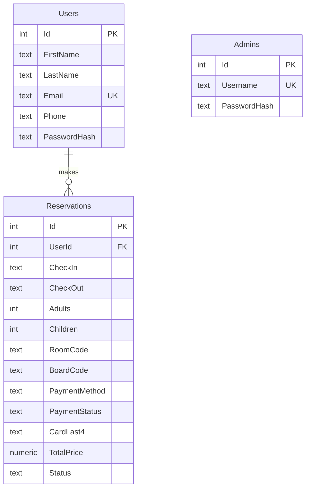

# Hotel Reservation System

A Windows desktop application for booking hotel rooms, built with **C#**, **Windows Forms** and **SQLite**. Guests can register, book rooms with live price and availability checks, pay by card or at the hotel, and manage their reservations. Administrators get an overview of all bookings and revenue.

## Features

**Guests**
- Register and sign in with a hashed password
- Choose dates, number of guests, room type and board option
- See the total price and room availability update as the selection changes
- Review the reservation before confirming
- Pay by card (simulated, validated with the Luhn algorithm) or choose to pay at the hotel
- View and cancel upcoming reservations

**Administrators**
- Sign in with a separate administrator account
- View all reservations, optionally including cancelled ones
- See active and upcoming stays, paid revenue and outstanding payments
- Cancel any active reservation

**Business rules**
- Six room types, each with its own capacity, nightly price and number of rooms
- A room type cannot be booked when all of its rooms are taken for overlapping dates
- Back-to-back stays are allowed (check-out and the next check-in on the same day)
- Total price = (room price + board price) × number of nights
- Stays must start today or later and last between 1 and 30 nights

## Architecture

The solution separates business logic from the user interface, so the logic can be tested without opening any windows.

```
HotelReservation.sln
├── src
│   ├── HotelReservation.Core          Class library (.NET 8)
│   │   ├── Data                       SQLite schema, repositories, demo data
│   │   ├── Models                     Rooms, board options, reservations, users
│   │   ├── Security                   PBKDF2 password hashing
│   │   ├── Services                   Pricing and booking rules
│   │   └── Validation                 Input and payment card validation
│   └── HotelReservation.App           Windows Forms application (.NET 8)
│       ├── Forms                      Welcome, sign-in, booking, payment, overview
│       └── UI                         Shared theme and dialog layout
└── tests
    └── HotelReservation.Core.Tests    xUnit tests for the core library
```

## Database

The SQLite database is created automatically on first start in `%LOCALAPPDATA%\HotelReservation\hotel.db` and filled with demo data. The schema is defined in [`schema.sql`](src/HotelReservation.Core/Data/schema.sql).



Availability is checked with an interval-overlap query inside a transaction, so two bookings cannot take the last room of a type at the same time:

```sql
SELECT COUNT(*)
FROM Reservations
WHERE RoomCode = $roomCode
  AND Status = 'Active'
  AND CheckIn < $checkOut
  AND CheckOut > $checkIn;
```

## Security

- Passwords are hashed with **PBKDF2-SHA256** (100,000 iterations, random salt per password) and compared in constant time
- All SQL queries use **parameters**, which prevents SQL injection
- Card numbers and security codes are **never stored** – only the last four digits are saved for reference
- Guests can only view and cancel their own reservations

## Getting started

**Requirements:** Windows 10 or 11 and either Visual Studio 2022 (with the *.NET desktop development* workload) or the [.NET 8 SDK](https://dotnet.microsoft.com/download/dotnet/8.0).

**Visual Studio:** open `HotelReservation.sln`, set `HotelReservation.App` as the startup project and press F5.

**Command line:**

```bash
dotnet run --project src/HotelReservation.App
```

**Run the tests:**

```bash
dotnet test
```

### Demo accounts

| Role | Sign-in | Password |
|---|---|---|
| Guest | `guest@demo.test` | `Guest123!` |
| Administrator | `admin` | `Admin123!` |

Test card for the simulated payment: `4242 4242 4242 4242`, any future expiry date and any three-digit CVV.

## Project history

The first version (2025) was a .NET Framework 3.5 application with a Microsoft Access database accessed through an ODBC data source. In 2026 it was rebuilt to:

- move to .NET 8 and SQLite, so the project runs without any manual database setup
- separate business logic into a testable class library and add unit tests
- hash passwords, stop storing card data and move the administrator account into the database
- show administrators the actual reservations from the database
- add availability checks, multi-night pricing and input validation
- redesign the interface with a consistent visual style

## Author

**Amina Mahmutović** – AI & Data Engineering student, International University of Sarajevo
